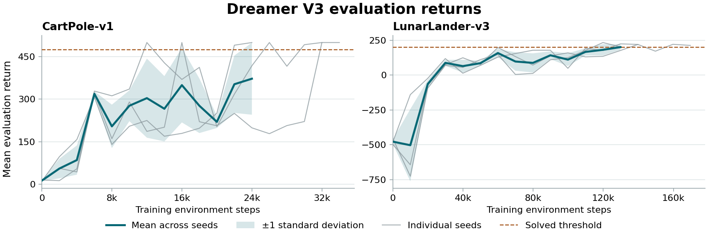

# Dreamer V1、V2、V3 实践

本案例用 PyTorch 实现 Dreamer V1、V2、V3 的教学示例，在 `CartPole-v1` 和离散 `LunarLander-v3` 上学习向量观测下的控制策略。真实轨迹用来训练世界模型并提供想象起点，actor 和 critic 的主要更新来自模型生成的轨迹。

## 快速开始

在仓库根目录使用已有 PyTorch 的 Python 环境。实验依赖 Gymnasium 1.2.3 和 Box2D。

```bash
python -m pip install 'gymnasium[box2d]==1.2.3' 'numpy==1.26.4' matplotlib
python ding/bonus/dreamer/train.py --env CartPole-v1 --versions v1 --seeds 0 \
  --workdir runs/dreamer-cartpole-example
```

## 复现实验

### 训练配置

完整实验矩阵包含两个环境、三个版本和训练种子 0、1、2。默认 CPU 使用单线程，每 4 次策略决策更新一次，每次采样 16 条长度为 16 的序列。可通过 `--device cuda:0` 使用 GPU。

```bash
python ding/bonus/dreamer/train.py --workdir runs/dreamer-matrix
python ding/bonus/dreamer/plot_returns.py --workdir runs/dreamer-matrix
```

| 环境 | 默认决策预算 | 评估间隔（决策次数） | 每次决策最多执行的环境步数 | 达标均分 |
| --- | ---: | ---: | --- | ---: |
| `CartPole-v1` | 60,000 | 2,000 | 各版本 1 步 | 475 |
| `LunarLander-v3` | 260,000 | 5,000 | V1/V2 为 3 步，V3 为 2 步 | 200 |

动作重复在回合结束时立即停止，奖励按实际执行的环境步累加。V2 在 CartPole 上使用 REINFORCE 和 0.1 的 KL 权重，在 LunarLander 上使用 90% 路径梯度、10% REINFORCE，actor 学习率为 `0.00008`。`train.py --help` 列出可配置项，`--full-budget` 可保留到预算结束的完整曲线。[环境预设](train.py#L139)

### 复现已达标的训练

以下命令使用实测达标的训练种子。CartPole 使用单线程 CPU。LunarLander 使用 CUDA，回报按 Gymnasium 1.2.3 和 Box2D 2.3.10 计算。实验使用 Python 3.11、PyTorch 2.6.0、NumPy 1.26.4 和 NVIDIA L20X。

```bash
python ding/bonus/dreamer/train.py --env CartPole-v1 --versions v1 v2 v3 --seeds 0 \
  --workdir runs/dreamer-book
python ding/bonus/dreamer/train.py --env LunarLander-v3 --versions v1 v2 --seeds 42 \
  --device cuda:0 --workdir runs/dreamer-book
python ding/bonus/dreamer/train.py --env LunarLander-v3 --versions v3 --seeds 0 \
  --device cuda:0 --workdir runs/dreamer-book
python ding/bonus/dreamer/plot_returns.py --workdir runs/dreamer-book
```

LunarLander 的 V1 还可以用训练种子 2 加 `--critic-lr 0.00008` 复现达标结果，该学习率来自 V1 论文。

### 评估与输出

周期评估在真实环境中使用固定的 20 个环境种子和贪心动作，RSSM 后验按独立的 Torch 随机序列采样。连续两次周期评估达到门槛，再用独立的 100 局确认。两项条件同时满足才记为达标。确认失败时继续训练，直到后续确认通过或预算用尽。所有评估均统计每局的原始累计奖励。[评估与确认](train.py#L222)

每个环境、版本和种子分别保存 `config.json`、`metrics/eval_returns.csv`、含确认评估逐局回报的 `result.json` 和推理用的 `policy.pt`。日志中的 `step` 记录决策次数，结果表中的环境步数和曲线横轴均按训练中的实际 `env.step()` 调用计数。聚合曲线在各训练种子共有的步数区间内插值，计算均值和标准差。[曲线聚合](plot_returns.py#L47)

## 实测收敛

| 环境 | 版本 | 达标种子数 | 达标种子的独立 100 局均分 | 确认时的原始环境步数 |
| --- | --- | ---: | ---: | ---: |
| CartPole-v1 | V1 | 3 / 3 | 495.64–500.00 | 10,000–30,000 |
| CartPole-v1 | V2 | 3 / 3 | 495.80–500.00 | 18,000–42,000 |
| CartPole-v1 | V3 | 3 / 3 | 500.00 | 24,000–34,000 |
| LunarLander-v3 | V1 | 1 / 7 | 223.23 | 283,968 |
| LunarLander-v3 | V2 | 3 / 4 | 205.49–232.01 | 238,682–506,625 |
| LunarLander-v3 | V3 | 3 / 3 | 213.69–231.63 | 129,789–169,663 |

LunarLander 的 V1 对种子最敏感。默认学习率下，种子 42 达标，种子 0–2 和 3–5 分别在 220,000 和 260,000 次决策预算内未达标。种子 2 使用上文的 critic 学习率变体，在 747,549 个原始环境步时取得 217.06 分。V2 的种子 1、2、42 达标，种子 0 在 260,000 次决策内未达标。CartPole 的各版本和 LunarLander 的 V3 均使用种子 0、1、2。

同一 CPU 核心上的微基准使用 16 条长度为 16 的序列和 15 步想象视界，统计预热后 150 次更新的中位耗时。V1 为 83.6 → 85.3 ms，V2 的 REINFORCE 配置为 164.0 → 83.5 ms，V3 为 194.2 → 131.5 ms。LunarLander V2 的混合梯度配置为 137.9 ms。[对比基线 PR #879](https://github.com/opendilab/DI-engine/pull/879/changes)

### V3 评估回报曲线

图中使用 V3 种子 0、1、2 的周期评估均分（`avg_return`，每次 20 局）。粗线和阴影显示三个种子在共有步数区间内的均值和 ±1 个标准差，细线延伸至各自的停训点。虚线标出环境的达标门槛。[曲线聚合](plot_returns.py#L47)



## 从 DreamerV3 到 Dreamer 4

DreamerV3 探索用一组超参数处理视觉与低维观测、离散与连续动作、以及不同的奖励尺度。DILab 的知乎专栏用 Minecraft 在线从零学会采钻石的实验说明这一目标，并梳理了 `symlog`、KL balancing、free bits 和回报缩放在其中的作用。[DILab 的世界模型综述](https://zhuanlan.zhihu.com/p/696752967) · [知乎专栏](https://www.zhihu.com/column/c_1764105923730083840) · [DreamerV3 Nature 论文](https://www.nature.com/articles/s41586-025-08744-2)

**Dreamer 4** 是该系列的后续研究，延续想象训练，并把世界模型扩展到从视频学习的因果 Transformer。论文的训练分三阶段。[Dreamer 4 论文](https://arxiv.org/abs/2509.24527)

1. **预训练世界模型。** 因果 tokenizer 将视频压缩成连续表征，动作条件 Transformer 预测后续表征。`shortcut forcing` 让模型学习在不同信号水平和步长下去噪，用两个半步的预测监督一个大步，论文的交互推理配置每帧用四次前向生成。预训练可同时利用有动作标注的轨迹和无动作标注的视频。[因果 tokenizer](https://arxiv.org/html/2509.24527v1#S3.SS1) · [动作条件动力学](https://arxiv.org/html/2509.24527v1#S3.SS2)
2. **微调策略和奖励头。** 用带动作和任务奖励的离线数据做行为克隆与奖励预测，同时保留视频预测训练。[论文第 3.3 节](https://arxiv.org/html/2509.24527v1#S3.SS3)
3. **在想象中做离线强化学习。** 冻结 Transformer，从数据集中的视频片段出发生成想象轨迹。价值头拟合 λ-return，策略头用 PMPO 按优势的正负分别强化或抑制采样动作，并用 `KL(π || π_prior)` 约束策略与行为克隆先验的偏离。论文使用固定的 VPT 数据训练，最终在真实 Minecraft 环境中评估并采到钻石。[想象训练](https://arxiv.org/html/2509.24527v1#S3.SS3) · [离线钻石实验](https://arxiv.org/html/2509.24527v1#S4.SS1)

## 算法原理与代码导读

### 真实回放训练世界模型

回放在单个回合内采样连续窗口，每一行是 `(观测 x_t, 上一步动作 a_{t-1}, 奖励 r_t, 是否终止)`。回合首行的动作编号为 `-1`，训练时映射成全零向量。[回放格式](dreamer/replay.py#L21) · [动作编码](dreamer/agent.py#L184)

RSSM 用 GRU 根据上一步状态和动作算出确定性记忆 `h_t`。先验 `p(z_t | h_t)` 预测随机潜变量，后验 `q(z_t | h_t, x_t)` 加入当前观测的编码。拼接后的 `[h_t, z_t]` 同时供观测解码器、奖励头、continuation 头、actor 和 critic 使用。本例采用小型 MLP 和单层 GRU，V1/V2 可用随机预采样的固定统计量归一化观测。[RSSM](dreamer/rssm.py#L59)

`WorldModel.loss()` 在后验特征上重建观测、预测真实奖励和继续概率，并用 `KL(q || p)` 训练先验预测后验。真正终止的 continuation 标签为 `0`。时间上限触发环境和采集状态重置，回放中的截断转移仍允许价值 bootstrap。[世界模型损失](dreamer/agent.py#L93) · [终止与截断处理](train.py#L56)

### 想象轨迹训练策略与价值

`_behavior_loss()` 从真实序列中取后验状态，首帧提供上下文，其后的状态可作为想象起点。起点特征先 `detach()`。`_imagine()` 反复用当前 actor 采样动作，再用 `rssm.img_step()` 从先验预测下一状态。默认想象 15 次决策，整段由模型生成，动作可与回放中原先执行的动作不同。[想象起点与 rollout](dreamer/agent.py#L220)

奖励和折扣从**执行动作后的下一状态**预测。`lambda_return()` 用下面的递推构造价值目标，其中 `d[t+1] = γ × 预测继续概率`。想象末尾用 critic 的预测价值补齐未来回报。[λ-return](dreamer/agent.py#L120)

```text
G[t] = r[t+1] + d[t+1] × ((1 − λ) × V(s[t+1]) + λ × G[t+1])
```

想象 critic 用分离梯度的状态特征和 `returns.detach()` 拟合目标 `G[t]`。各时间步的损失按到达该状态之前的累计折扣加权。`train_step()` 将损失汇总后调用一次 `backward()`，再用各自的优化器更新世界模型、actor 和 critic。下面的梯度路径决定每项损失会训练哪些参数。[训练步骤](dreamer/agent.py#L184) · [累计折扣](dreamer/agent.py#L132)

### Actor 梯度如何穿过动作采样

- **路径梯度**沿 `λ-return → 奖励、折扣和价值预测 → RSSM 想象状态 → 动作 → actor` 回传。冻结世界模型和相关 critic 的参数会保留输出对输入的梯度。每步 actor 的状态输入也会 `detach()`，跨步梯度仍可沿 RSSM 的状态递推传播。[冻结参数](dreamer/agent.py#L17) · [想象中的动作采样](dreamer/agent.py#L227)
- **离散动作的直通估计**用 `one_hot + (probs - probs.detach())`。前向取样得到硬 one-hot，反向用分类概率的导数近似动作采样的梯度。[直通动作实现](dreamer/agent.py#L233)
- **连续动作的重参数化**可写成 `a = μ + σ * ε`，其中 actor 输出 `μ` 和 `σ`，噪声 `ε` 独立采样。PyTorch 可用 `Normal(μ, σ).rsample()`，有界动作还可接 `tanh`。这样回报对动作的梯度会沿可导的采样变换回到 `μ` 和 `σ`。本案例的运行入口面向离散动作。[V1 连续动作实现](https://github.com/google-research/dreamer)
- **REINFORCE** 对两种动作空间都适用。把想象动作和分离梯度的优势 `A = G − V(s)` 当作固定样本，对 `−log_prob(a) * A` 求导。正优势提高该动作的概率或概率密度，负优势降低它。梯度沿 `log_prob(a) → actor` 传播，想象轨迹提供训练数据。[REINFORCE 目标](dreamer/agent.py#L313)

### V1 的高斯潜变量与路径梯度

**世界模型**用高斯潜变量，`RSSM._sample()` 以 `mean + std * noise` 重参数化。对先验和后验共同计算 KL，先对整批求平均，再应用 3 nats 的下限。[采样](dreamer/rssm.py#L74) · [KL](dreamer/agent.py#L74)

**Actor 和 critic** 使用可微的想象轨迹。Actor 最大化 λ-return，离散动作走直通路径，计算回报时冻结世界模型和在线 critic 的参数。随后 critic 用平方误差拟合该回报，λ-return 的 bootstrap 也来自在线 critic。[V1 的 `_actor_critic_loss()`](dreamer/agent.py#L247) · [V1 论文](https://arxiv.org/abs/1912.01603)

### V2 的分类潜变量与混合策略梯度

**世界模型**用多组分类潜变量，每组采样一个直通 one-hot。KL balancing 将 `KL(q.detach(), p)` 与 `KL(q, p.detach())` 按 `0.8 / 0.2` 加权，分别训练先验逼近后验、后验产生更可预测的表示。[分类采样](dreamer/rssm.py#L74) · [KL balancing](dreamer/agent.py#L74)

**Actor 和 critic** 用 `torch.lerp(reinforce_objective, returns, mix)` 混合 REINFORCE 与路径梯度，再加熵奖励。`--v2-dynamics-mix` 是路径梯度比例，对应论文中的 `1 − ρ`。`mix = 0` 时在 `torch.no_grad()` 下生成轨迹。目标 critic 提供 bootstrap 和优势 baseline，每 100 次行为更新从在线 critic 复制参数。在线 critic 用平方误差拟合 λ-return。[V2 行为损失](dreamer/agent.py#L296) · [V2 论文](https://arxiv.org/abs/2010.02193) · [V2 官方实现](https://github.com/danijar/dreamerv2/tree/07d906e9c4322c6fc2cd6ed23e247ccd6b7c8c41)

### V3 的尺度处理与回放价值

**世界模型**用 `symlog(x) = sign(x) * log(1 + |x|)` 压缩向量观测和重建目标。分类潜变量和策略混入 1% 的均匀概率。每个样本、每个时间步的动力学与表示 KL 各自应用 1 nat 的下限，再按 Nature 版的 `1 / 0.1` 加权。[V3 世界模型](dreamer/agent.py#L44) · [均匀概率混合](dreamer/models.py#L17)

**奖励与价值**用 `SymexpTwoHot` 预测 255 个桶的概率。桶中心由 `symexp` 生成，目标在原始数值尺度上分配给相邻两个桶，交叉熵拟合这两个权重，预测时取桶中心的概率加权均值。在线 critic 参与 λ-return 的 bootstrap，指数移动平均的慢速 critic 提供正则目标。[SymexpTwoHot](dreamer/models.py#L61) · [V3 价值损失](dreamer/agent.py#L341)

**Actor** 用 `torch.no_grad()` 生成想象轨迹，再用 REINFORCE 和熵奖励更新策略。先跟踪回报第 5 和第 95 百分位的指数移动平均，再把优势除以两者的差值，分母至少为 1。这样能随任务回报的尺度调整策略梯度的量级。[想象和策略更新](dreamer/agent.py#L296) · [优势缩放](dreamer/agent.py#L348)

**回放价值损失**用真实奖励构造辅助 λ-return，bootstrap 来自下一真实后验状态起算的想象回报。该分支的后验特征保留梯度，辅助损失同时训练 critic、编码器和 RSSM 表示。[V3 的 `_replay_loss()`](dreamer/agent.py#L360) · [V3 官方实现](https://github.com/danijar/dreamerv3/tree/e01491fad6434b2245a3b8ca201dd7faedcc458c)

### 如何理解价值估计的准确性

想象 critic 拟合的是当前模型下的回报，真实环境中的价值精度取决于模型对当前策略所访问状态的预测质量。例如，模型若把一次坠毁预测成安全降落，较小的 critic 损失也可能对应偏高的真实价值估计。真实数据持续校正世界模型，有限的 rollout 抑制多步预测误差的累积，V3 的辅助损失再用真实奖励约束价值。[世界模型更新](dreamer/agent.py#L93) · [回放价值损失](dreamer/agent.py#L360)

上文的独立 100 局评估衡量真实环境中的策略表现。直接检查 critic 时，可固定同一策略，用留出的真实轨迹推断后验状态，再将 `V(s_t)` 与相同折扣和终止规则下的实测后续回报比较。
